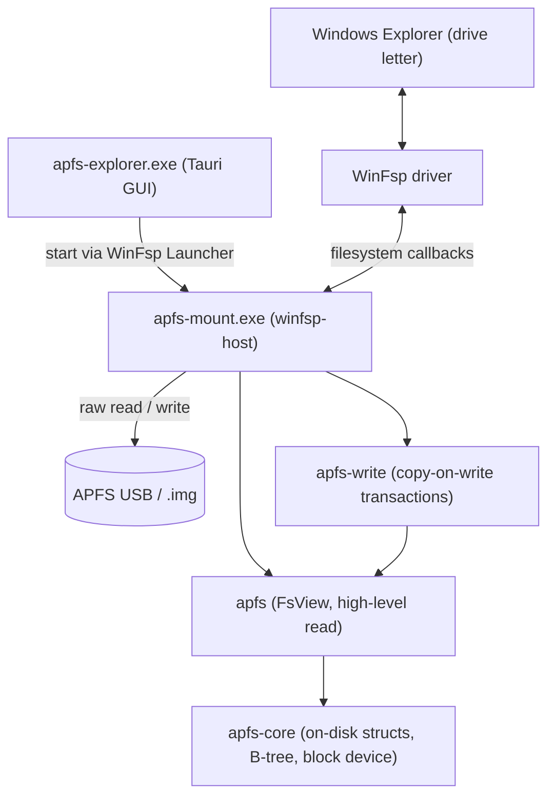

<p align="center">
  
</p>

<h1 align="center">APFS Explorer for Windows</h1>

<p align="center"><strong>Open-source APFS read-write for Windows. Audit-verified. Real-disk tested.</strong></p>

> [!WARNING]
> **Experimental software - do not use on important data.** APFS Explorer is a
> young, independent APFS implementation. The read path is well-exercised, but
> **write support is experimental and can corrupt a volume.** Always keep backups,
> prefer read-only mounts, and never make this tool the only copy of data you care
> about. Provided "as is", without warranty of any kind (see GPL-3.0 §15-16).

---

[](https://github.com/enesilhaydin/apfs-explorer/releases)
[](https://github.com/enesilhaydin/apfs-explorer/releases)
[](https://github.com/enesilhaydin/apfs-explorer/stargazers)
[](LICENSE)
[](https://www.rust-lang.org/)
[](https://winfsp.dev/)

---

## Quick Install

1. Download the latest `apfs-explorer-setup.exe` from the [Releases page](https://github.com/enesilhaydin/apfs-explorer/releases).
2. Run it as administrator - WinFsp is auto-installed if absent.
3. Launch **APFS Explorer** (it asks for administrator rights once, when it opens), pick your APFS USB drive, and click **Mount** - it appears as a drive letter you can browse. The window shows the version and build under its title.

---

## Features

| Feature | Status |
|---|---|
| Read-write mount (drive letter), read-only by default | ✅ Full |
| Writes change only the blocks they touch (append, overwrite in the middle, truncate) | ✅ Full |
| Files macOS stored compressed (zlib, LZVN, LZFSE, LZBITMAP): read; written back uncompressed | ✅ Full |
| Clones macOS made: read; writing to one side copies only that file's stream | ✅ Full |
| Many operations to one checkpoint (write grouping, at most ~1 s open) | ✅ Full |
| Snapshot create / list / delete / revert | ✅ Full |
| Clone (reflink) via CLI / image | ✅ Full |
| Symlink + Windows reparse round-trip | ✅ Full |
| BSD flags (hidden, immutable, append-only) | ✅ Full |
| NFD normalization + full Unicode case-fold | ✅ Full |
| Image-mount mode (`.img` / `.dmg` raw, whole disk or bare container) | ✅ Full |
| CLI subcommands (mount, snapshot, clone, volume list) | ✅ Full |
| Desktop GUI (detect / mount / browse / unmount) | ✅ Full |
| Audit-verified against reference implementations | ✅ Full |
| Real-disk validated against macOS (fsck-clean, macOS keeps editing what we wrote) | ✅ Full |
| Hard links: read | ✅ Full |
| Hard links: create | 🚧 Library only; WinFsp has no hard-link support |
| FileVault / sealed / Fusion Drive | 🚫 Out of scope |

---

## Performance

APFS Explorer (user space, through WinFsp) against NTFS on the same USB
drive (a 64 GB KIOXIA TransMemory stick on USB 3, Windows 11 Pro 25H2): the
drive formatted APFS on a Mac and mounted with `apfs-mount --drive N
--writable`, then formatted NTFS by Windows. PowerShell `Copy-Item` /
`Rename-Item` / `Remove-Item` and .NET `FileStream`; median of three runs.
A write is timed until it is on the drive (the APFS mount stopped, which
commits its last group; NTFS flushed). "Cold" reads come after a remount
(APFS) or a dismount (NTFS).

| Workload | APFS Explorer | NTFS |
|---|---:|---:|
| Copy 300 files of 4 KiB into a folder | 1.6 s | 4.6 s |
| Rename those 300 files | 231 ms | 1.8 s |
| Delete 150 of them | 123 ms | 531 ms |
| Copy 2000 files of 4 KiB into a folder | 6.3 s | 31.2 s |
| Copy a 256 MiB file | 19.8 s | 15.8 s |
| Copy a 1 GiB file | 85 s | 72 s |
| 1000 scattered 4 KiB writes into the 256 MiB file | 1.8 s | 3.7 s |
| List a 2000-file folder, cold / warm | 142 / 48 ms | 68 / 33 ms |
| Read the edited 256 MiB file in 4 KiB requests, cold / warm | 6.2 / 6.0 s | 2.2 / 0.27 s |
| Read 1 GiB in 1 MiB requests, cold | 6.7 s | 5.3 s |
| Hash 2000 small files, cold | 4.9 s | 3.8 s |

Why it goes both ways:

- Windows mounts NTFS on a removable drive for quick removal, without
  write caching, so each metadata change waits for the drive. The APFS
  mount gathers changes into write groups and commits a group at most
  about a second after its last operation (and when you unmount), so many
  small operations share one write to the drive.
- Large files: every write and read crosses from the kernel to the
  user-space process and back, and a 1 GiB copy writes about 15% slower
  than NTFS.
- APFS writes an edit to new blocks (copy-on-write), so a file edited in
  many places is read from several places on the drive; NTFS edits in
  place. And Windows does not cache file data on the mount (with WinFsp's
  data caching on, copies of 4 GiB files hung in the kernel), so a file
  read twice is read from the drive twice, where NTFS answers the second
  time from memory.

Memory: the mount process holds a few MB of its own idle, 6 to 15 MB
through a 5-minute mixed workload (12 000 operations), and at most about
60 MB while copying 10 000 files or editing a 2 GiB file; its metadata
cache is capped at 64 MiB.

---

## Tested Platforms

| Platform | Architecture | WinFsp | Status |
|---|---|---|---|
| Windows 11 Pro 25H2 (build 26200) | AMD64 | 2.1 (2025) | ✅ Primary (dev + test) |
| Windows 10 21H2 | AMD64 | 2.1 | ⚠️ Expected (same WinFsp 2.1 ABI; not regularly tested) |
| macOS 26 | arm64 | - | ✅ Library crates; fsck and differential tests against macOS, on images and a real USB drive |

---

## Architecture



Crate layering: `apfs-core` (on-disk format + B-tree engine) is the base; `apfs`
builds the read-only `FsView` on top; `apfs-write` adds copy-on-write mutation;
`winfsp-host` (the `apfs-mount.exe` binary) wires all three into WinFsp callbacks.
The GUI never links the engine: it starts `apfs-mount.exe` through the WinFsp
Launcher so the drive is visible to a non-elevated Explorer.

---

## CLI Usage

```sh
# Mount physical disk N (from \\.\PhysicalDriveN) at drive letter M: (read-only)
apfs-mount --drive 2 --mount M:

# Mount a raw .img / .dmg at an auto-assigned letter
apfs-mount --image disk.img

# Opt in to read+write (default is read-only)
apfs-mount --drive 2 --mount M: --writable

# A container holds several volumes; the default is the user data volume.
# Pick another by UUID, role or index (see `volume list`):
apfs-mount --drive 2 --volume-role system
apfs-mount --image disk.img --volume-index 1
apfs-mount --image disk.img --volume-uuid 1F2E3D4C-5B6A-7980-A1B2-C3D4E5F60718

# One-shot subcommands (no WinFsp needed). --image takes a whole-disk image
# (GPT) or a bare container; the snapshot ones also take --drive N, a drive
# that is not mounted (they refuse one that is):
apfs-mount volume   list   --image disk.img
apfs-mount snapshot list   --drive 2
apfs-mount snapshot create --image disk.img --name before-edit
apfs-mount snapshot delete --drive 2 --xid 0x1a2   # xid as `snapshot list` prints it
apfs-mount snapshot revert --image disk.img --xid 0x1a2
apfs-mount clone           --image disk.img --src /a.txt --dst /b.txt
```

---

## Use as a Rust Library

```toml
# Cargo.toml - not yet published to crates.io; use a git dependency
[dependencies]
apfs = { git = "https://github.com/enesilhaydin/apfs-explorer" }
apfs-core = { git = "https://github.com/enesilhaydin/apfs-explorer" }
```

```rust
use apfs::FsView;
use apfs_core::block_device::{BlockDevice, FileBlockDeviceRw, WritableOffsetBlockDevice};
use apfs_core::gpt::find_apfs_container;

// A whole-disk image (GPT) holds the container in a partition; a bare
// container image starts with it.
let mut disk = FileBlockDeviceRw::open_rw("disk.img")?;
let (offset, length) = match find_apfs_container(&mut disk, 512) {
    Ok(range) => (range.offset, range.length),
    Err(_) => (0, disk.size()),
};
let mut fs = FsView::open(WritableOffsetBlockDevice::new(disk, offset, length))?;
for entry in fs.read_dir("/")? {
    println!("{}", entry.name);
}
let head = fs.read("/notes.txt", 0, 4096)?; // only the bytes asked for
```

The full program is `crates/apfs/examples/list_dir.rs`
(`cargo run -p apfs --example list_dir -- disk.img /`). Writing goes through
`apfs_write` (`Transaction`, `write_file`, `write_range`, `create_snapshot`, ...).
Run `cargo doc --open -p apfs-core -p apfs -p apfs-write` for the full API.

---

## Desktop App

The desktop app (`apfs-explorer.exe`) is a single-window GUI that lists detected
APFS disks and disk images.

- **Detected drives** are listed automatically; click **Mount** to attach one as
  a drive letter (the app, elevated once when it opens, starts
  `apfs-mount.exe` through the WinFsp launcher, so the drive is visible to
  Explorer).
- **Mounted volumes** show their drive letter with **Open in Explorer** and
  **Unmount** actions.
- Mounts are **read-only by default**; writing is an explicit opt-in.

---

## Installation Details

### WinFsp Note

WinFsp (`winfsp.sys`) is a signed kernel driver and cannot be embedded in the installer directly.
The Burn bundle chains the official WinFsp MSI (sourced from <https://winfsp.dev/rel/>) and installs it
silently on first run when absent. No separate download is needed.

### Known Limitations

- Creating hard links and FSCTL clones from Windows is not possible: WinFsp
  has no hard-link support. The library can create hard links.
- Writing to a file macOS stored compressed writes it back uncompressed (as
  macOS itself does on the first write to one).
- A volume that has snapshots is mounted read-only even when writing was
  asked for. The library writes under snapshots (and its tests check the
  result with `fsck_apfs`), but it rewrites the whole catalog for every
  operation there: on a USB drive holding 120 000 files, deleting 20 files
  under a snapshot took 11 s. Delete the snapshots (on a Mac, or with
  `apfs-mount snapshot delete --drive N` while the drive is not mounted) to
  write from Windows.
- Extended attributes (xattrs) are not shown to Windows programs.
- Write support requires WinFsp 2.1 or later.
- FileVault / sealed volumes / Fusion Drive: not supported (out of scope).
- Library on macOS against a raw disk device (`/dev/rdiskN`): the device
  refuses `F_FULLFSYNC`, which `FileBlockDeviceRw::flush_data` uses, so a
  commit fails at its first durability barrier. Wrap the device and issue
  `DKIOCSYNCHRONIZE` instead (`crates/apfs-write/tests/real_usb.rs` shows
  how). The Windows mount is not affected.

### Uninstall

Use **Windows Settings → Apps → "APFS Explorer for Windows" → Uninstall**.
The WinFsp launcher-class registration is removed with the product MSI.
WinFsp itself is marked `Permanent="yes"` in the bundle; it is not removed on
uninstall (other applications may depend on it).

---

## FAQ

**Is write safe?**
It is designed to be, and it is tested hard, but it is still experimental (see
the warning at the top): keep backups. Every change is copy-on-write: new
blocks are written and made durable before the checkpoint that points to them,
so an interrupted write leaves the volume at the previous checkpoint, never
half-written. Each change is checked against macOS `fsck_apfs`, and against
macOS itself editing what we wrote, in the test suites.

**Will I lose data on unplug?**
Use the app's **Unmount** action or the safely-remove-hardware flow first.
Operations are grouped and committed together, at most about a second after
the last one (and at once on unmount or a flush). Pulling the drive loses the
operations of the group still open, and anything a program has not yet
written out; the volume itself stays consistent at the last commit, and the
next mount starts from there. The mount notices the drive is gone within a
second and unmounts itself. Measured by pulling a USB drive three times in
the middle of a stream of writes: what was lost was the last 0.2 to 0.6 s of
writes, every file written before them read back intact, and none was
half-written.

**Does it work on Apple Silicon Mac-formatted volumes?**
Yes. APFS volumes formatted on Apple Silicon Macs use the same on-disk format
as Intel Macs.

**Snapshot compatibility?**
Snapshots created by APFS Explorer are compatible with macOS: `diskutil apfs
listSnapshots` shows them by name, and the volume passes `fsck_apfs` with them.

**Hard links?**
Reading existing hard links works. Creating them from Windows does not: WinFsp
has no hard-link support. The library can create them.

**Which APFS versions are supported?**
Unencrypted volumes written by macOS 10.13 through macOS 26, including
compressed files (zlib, LZVN, LZFSE, LZBITMAP), clones, snapshots and
NFD-normalized, case-insensitive or case-sensitive names.

**Read-only mode?**
Read-only is the **default** - both the GUI and `apfs-mount` mount read-only
unless you explicitly opt in to writing, so the volume is protected out of the box.

---

## Development

```sh
# The app bundles apfs-mount.exe, so it builds through `xtask package` (below);
# everything else builds directly:
cargo build --workspace --exclude apfs-explorer-gui
cargo test -p apfs-core -p apfs -p apfs-write --lib   # what CI runs
cargo fmt --all -- --check
cargo clippy -p apfs-core -p apfs -p apfs-write --lib  # advisory in CI
```

The integration suites build APFS images with macOS tools and check them with
`fsck_apfs`, so they run on a Mac:

```sh
APFS_WRITE_SCRATCH=1 cargo test -p apfs-core -p apfs -p apfs-write -p winfsp-host \
  --features apfs-write/write -- --include-ignored --test-threads=1
```

On Windows, `scripts/win-batch.ps1` drives a mounted image through Explorer-style
operations; `scripts/win-batch-verify.py` then checks the result on a Mac. See
`docs/refs/testing.md`.

### Building the Installer (Windows host required)

```sh
# 1. Stage the official WinFsp MSI (download from https://winfsp.dev/rel/)
copy winfsp-2.x.msi dist\winfsp.msi

# 2. Build binaries + MSI + Burn bundle
cargo run -p xtask -- package
# Output: dist\apfs-explorer-setup.exe
```

`xtask package` builds the Tauri product MSI (`cargo tauri build`) and wraps it in
the WiX Burn bundle that chains WinFsp. Prerequisites on the Windows host: the
Tauri CLI (`cargo install tauri-cli`) and the WiX v3 toolset (`candle.exe`,
`light.exe`) on PATH. On macOS the command prints the full recipe and exits cleanly.

---

## Acknowledgments

This project stands on the shoulders of prior art and published specifications:

| Project | Author | Role |
|---|---|---|
| [linux-apfs-rw](https://github.com/Ernesto-Fernandez/linux-apfs-rw) | Ernesto Fernández | Write-path reference, RW kernel module |
| [apfsprogs](https://github.com/Ernesto-Fernandez/apfsprogs) | Ernesto Fernández | fsck / mkfs userspace tools |
| [apfs-fuse](https://github.com/sgan81/apfs-fuse) | sgan81 | Independent C++ FUSE reader |
| [libfsapfs](https://github.com/libyal/libfsapfs) | libyal | Struct layout reference |
| [go-apfs](https://github.com/blacktop/go-apfs) | blacktop | Go reader, practical usage examples |
| [WinFsp](https://github.com/winfsp/winfsp) | Bill Zissimopoulos | Windows filesystem driver framework |
| APFS File System Reference | Apple Inc. | Published file system specification (PDF) |

---

## Contributing

See [CONTRIBUTING.md](CONTRIBUTING.md) for the contribution guide, code style, and PR process.

---

## License

GPL-3.0-only. See [LICENSE](LICENSE).

---

## Sponsor

If this project saves you money on proprietary APFS drivers, consider sponsoring:

[](https://github.com/sponsors/enesilhaydin)

---

## Star History

[](https://github.com/enesilhaydin/apfs-explorer/stargazers)
