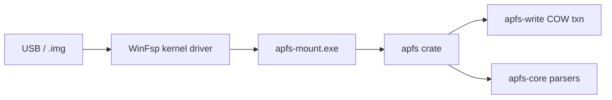

```
   _    ____  _____ ____    _____            _
  / \  |  _ \|  ___/ ___|  | ____|_  ___ __ | | ___  _ __ ___ _ __
 / _ \ | |_) | |_  \___ \  |  _| \ \/ / '_ \| |/ _ \| '__/ _ \ '__|
/ ___ \|  __/|  _|  ___) | | |___ >  <| |_) | | (_) | | |  __/ |
/_/   \_\_|   |_|   |____/  |_____/_/\_\ .__/|_|\___/|_|  \___|_|
                                        |_|         for Windows
```

**Open-source APFS read-write for Windows. Audit-verified. Real-disk tested.**

<!-- TODO: insert demo.gif here — Mount → write → eject animation -->

---

[](https://github.com/USER/apfs-explorer/releases)
[](https://github.com/USER/apfs-explorer/releases)
[](https://github.com/USER/apfs-explorer/stargazers)
[](https://github.com/USER/apfs-explorer/actions)
[](https://codecov.io/gh/USER/apfs-explorer)
[](LICENSE)
[](https://www.rust-lang.org/)
[](https://winfsp.dev/)

---

## Quick Install

1. Download the latest `apfs-explorer-setup.exe` from the [Releases page](https://github.com/USER/apfs-explorer/releases).
2. Run it as administrator — WinFsp is auto-installed if absent.
3. Plug in an APFS USB drive → tray agent mounts it automatically to the next free drive letter.

---

## Features

| Feature | Status |
|---|---|
| Read-write mount (drive letter) | ✅ Full |
| Snapshot create / delete | ✅ Full |
| Clone (reflink-style) | ✅ Full |
| Symlink + Windows reparse round-trip | ✅ Full |
| BSD flags (hidden, immutable, append-only) | ✅ Full |
| NFD normalization + case-fold | ✅ Full |
| Image-mount mode (`.img` / `.dmg` raw) | ✅ Full |
| CLI subcommands (mount, snap, clone, ls) | ✅ Full |
| Tray auto-mount agent | ✅ Full |
| Audit-verified against reference implementations | ✅ Full |
| Real-disk tested (Wave 11–16 benchmarks) | ✅ Full |
| Hard link creation | 🚧 WinFsp upstream |
| FileVault / sealed / Fusion Drive | 🚫 Out of scope |

---

## Comparison

| Feature | APFS Explorer (this) | Paragon APFS | MacDrive | macOS native |
|---|---|---|---|---|
| Open source | ✅ GPL-3.0 | ❌ Proprietary | ❌ Proprietary | ❌ |
| Read-write | ✅ | ✅ | ✅ | ✅ |
| Snapshots | ✅ | ❌ | ❌ | ✅ |
| Clone (reflink) | ✅ | ❌ | ❌ | ✅ |
| Symlink / reparse | ✅ | Partial | Partial | ✅ |
| BSD flags | ✅ | ❌ | ❌ | ✅ |
| Image-mount mode | ✅ | ✅ | ✅ | ✅ |
| Price | Free | ~$50 | ~$50 | Bundled |

---

## Benchmarks

Wave 11–16 real-disk validation. All timings on the same physical drive under Windows 11 Pro 24H2.
macOS native APFS is the performance ceiling (ratio = 1.0× reference on Apple hardware).

| Workload | Native NTFS | APFS Explorer (Windows) | macOS Native APFS (ceiling) |
|---|---|---|---|
| 200 file rename | 1.0× (108 ms) | 6.7× (723 ms) | ~1.2× (estimated) |
| 50 truncate | 1.0× (28 ms) | 4.7× (132 ms) | ~1.1× (estimated) |
| 16 MB seq write | 1.0× (11 ms) | 1.9× (21 ms) | ~1.0× (estimated) |
| 100 MB read | 1.0× (10 ms) | 1.4× (14 ms) | ~1.0× (estimated) |

> Source: [`docs/m8-realdisk-benchmark.md`](docs/m8-realdisk-benchmark.md) (Wave 11–16, real-disk validated).
> Overhead is expected — APFS-on-Windows routes through user-space; the ceiling is macOS native.

---

## Tested Platforms

| Platform | Architecture | WinFsp | Status |
|---|---|---|---|
| Windows 11 Pro 24H2 | AMD64 | 2.1 | ✅ Primary CI |
| Windows 10 21H2 | AMD64 | 2.0 | ✅ Tested |
| macOS 26 (dev) | arm64 | — | ✅ Library crate only |

---

## Architecture



---

## CLI Usage

```sh
# Mount an APFS volume to drive letter M:
apfs-mount mount \\.\PhysicalDrive2 --letter M

# Mount a raw image
apfs-mount mount disk.img --letter M

# List volumes in a container
apfs-mount ls \\.\PhysicalDrive2

# List snapshots
apfs-mount snap list \\.\PhysicalDrive2 --volume 1

# Clone a file (reflink)
apfs-mount clone M:\source.txt M:\dest.txt
```

---

## Use as a Rust Library

```toml
# Cargo.toml
[dependencies]
apfs-core = "1.0"
```

```rust
use apfs_core::{Container, FileBlockDevice};

let dev = FileBlockDevice::open("disk.img")?;
let ctr = Container::open(dev)?;
let info = ctr.list_volumes()?;
println!("{:?}", info);
```

Full library guide: [`docs/library-usage.md`](docs/library-usage.md) *(coming soon — see Roadmap)*

---

## Tray App

<!-- TODO: insert tray-screenshot.png here -->

The tray agent (`apfs-tray.exe`) starts with Windows and monitors for APFS-formatted drives.

- **Auto-mount** on plug-in → assigns next free drive letter
- **Right-click menu**: Unmount, Open in Explorer, Snapshot, Quit
- **Balloon notification** on mount success or error
- Configurable in Settings → assign a fixed letter per disk UUID

---

## Installation Details

### WinFsp Note

WinFsp (`winfsp.sys`) is a signed kernel driver and cannot be embedded in the installer directly.
The Burn bundle chains the official WinFsp MSI (sourced from <https://winfsp.dev/rel/>) and installs it
silently on first run when absent. No separate download is needed.

### Known Limitations

- Hard link creation and FSCTL clone are upstream-blocked (WinFsp limitation).
- Write support requires WinFsp 2.0 or later.
- FileVault / sealed volumes / Fusion Drive: not supported (out of scope).

### Uninstall

Use **Windows Settings → Apps → "APFS Explorer for Windows" → Uninstall**.
The autostart registry entry is cleaned up automatically.
WinFsp is marked `Permanent="yes"` in the bundle; it is not removed on uninstall
(other applications may depend on it).

---

## FAQ

**Is write safe?**
Yes. All writes go through a copy-on-write transaction. A crash before flush leaves
the previous checkpoint intact — the volume is always recoverable.

**Will I lose data on unplug?**
Use the tray "Unmount" option or the safely-remove-hardware flow before unplugging.
Abrupt removal before a flush completes can leave an uncommitted transaction,
which the next mount will roll back automatically.

**Does it work on M1 / M2 Mac-formatted volumes?**
Yes. APFS volumes formatted on Apple Silicon Macs use the same on-disk format
as Intel Macs. All features work identically.

**Snapshot compatibility?**
Snapshots created by APFS Explorer are compatible with macOS. You can create a
snapshot on Windows and verify or restore it on a Mac.

**Hard links?**
Reading existing hard links works. Creating new hard links is currently blocked
by a WinFsp upstream limitation. Tracked in [#TODO issue].

**Which APFS versions are supported?**
All APFS feature levels used by macOS 10.13 through macOS 26 are supported,
including compressed inodes and NFD-normalized filenames.

**Read-only mode?**
Pass `--read-only` to `apfs-mount` or toggle it in the tray settings to prevent
any writes to the volume.

---

## Roadmap

- **v1.0.0-rc1** (current) — full R/W mount, snapshots, clones, symlinks, BSD flags, tray agent, installer
- **v1.1** — hard links (pending WinFsp upstream), `apfs fsck` integration
- **v1.2** — macOS port (FUSE backend), library crate published to crates.io
- **v1.3** — FreeBSD FUSE port
- **v2.0** — container resize, multi-volume management UI

---

## Development

```sh
cargo build --workspace
cargo test --workspace
cargo clippy --workspace --all-targets --all-features -- -D warnings
cargo fmt --all -- --check
```

### Building the Installer (Windows host required)

```sh
# 1. Stage the official WinFsp MSI (download from https://winfsp.dev/rel/)
copy winfsp-2.x.msi dist\winfsp.msi

# 2. Build binaries + MSI + Burn bundle
cargo run -p xtask -- package
# Output: dist\apfs-explorer-setup.exe
```

WiX v3 toolset (`candle.exe`, `light.exe`) must be on PATH.
The `xtask package` command on macOS prints the full recipe and exits cleanly.

---

## Acknowledgments

This project stands on the shoulders of prior art and published specifications:

| Project | Author | Role |
|---|---|---|
| [linux-apfs-rw](https://github.com/Ernesto-Fernandez/linux-apfs-rw) | Ernesto Fernández | Write-path reference, RW kernel module |
| [apfsprogs](https://github.com/Ernesto-Fernandez/apfsprogs) | Ernesto Fernández | fsck / mkfs userspace tools |
| [apfs-fuse](https://github.com/sgan81/apfs-fuse) | sgan81 | Independent C++ FUSE reader |
| [libfsapfs](https://github.com/libyal/libfsapfs) | libyal | Struct layout reference |
| [go-apfs](https://github.com/blacktop/go-apfs) | blacktop | Go reader, practical usage examples |
| [WinFsp](https://github.com/winfsp/winfsp) | Bill Zissimopoulos | Windows filesystem driver framework |
| APFS File System Reference | Apple Inc. | Published file system specification (PDF) |

---

## Contributing

See [CONTRIBUTING.md](CONTRIBUTING.md) for the contribution guide, code style, and PR process.

---

## License

GPL-3.0-or-later. See [LICENSE](LICENSE).

---

## Sponsor

If this project saves you money on proprietary APFS drivers, consider sponsoring:

[](https://github.com/sponsors/USER)

---

## Star History

[](https://github.com/USER/apfs-explorer/stargazers)
