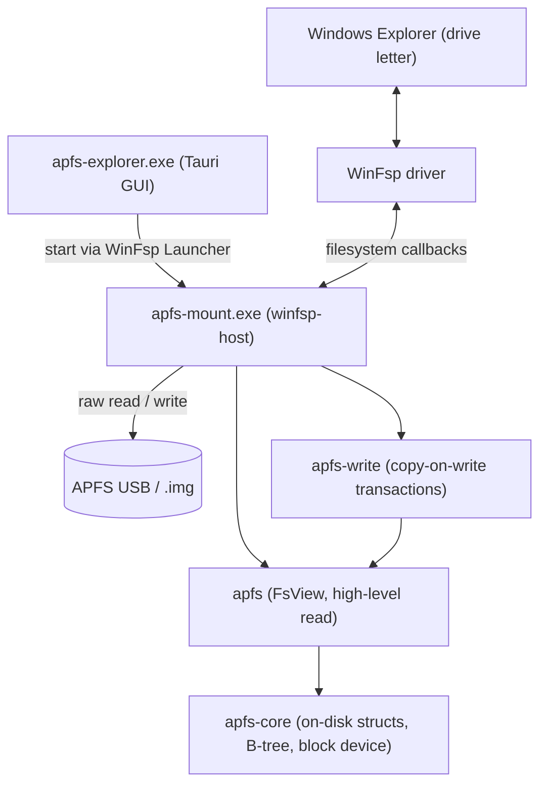

<p align="center">
  
</p>

<h1 align="center">APFS Explorer for Windows</h1>

<p align="center"><strong>Open-source APFS read-write for Windows. Audit-verified. Real-disk tested.</strong></p>

> [!WARNING]
> **Experimental software - do not use on important data.** APFS Explorer is a
> young, independent APFS implementation. The read path is well-exercised, but
> **write support is experimental and can corrupt a volume.** Always keep backups,
> prefer read-only mounts, and never make this tool the only copy of data you care
> about. Provided "as is", without warranty of any kind (see GPL-3.0 §15-16).

---

[](https://github.com/enesilhaydin/apfs-explorer/releases)
[](https://github.com/enesilhaydin/apfs-explorer/releases)
[](https://github.com/enesilhaydin/apfs-explorer/stargazers)
[](LICENSE)
[](https://www.rust-lang.org/)
[](https://winfsp.dev/)

---

## Quick Install

1. Download the latest `apfs-explorer-setup.exe` from the [Releases page](https://github.com/enesilhaydin/apfs-explorer/releases).
2. Run it as administrator - WinFsp is auto-installed if absent.
3. Launch **APFS Explorer**, pick your APFS USB drive (or a disk image), and click **Mount** - it appears as a drive letter you can browse.

---

## Features

| Feature | Status |
|---|---|
| Read-write mount (drive letter) | ✅ Full |
| Snapshot create / delete | ✅ Full |
| Clone (reflink) via CLI / image | ✅ Full |
| Symlink + Windows reparse round-trip | ✅ Full |
| BSD flags (hidden, immutable, append-only) | ✅ Full |
| NFD normalization + case-fold | ✅ Full |
| Image-mount mode (`.img` / `.dmg` raw) | ✅ Full |
| CLI subcommands (mount, snapshot, clone, volume list) | ✅ Full |
| Desktop GUI (detect / mount / browse / unmount) | ✅ Full |
| Audit-verified against reference implementations | ✅ Full |
| Real-disk validated against macOS (fsck-clean) | ✅ Full |
| Hard link creation | 🚧 WinFsp upstream |
| FileVault / sealed / Fusion Drive | 🚫 Out of scope |

---

## Performance

Real-disk micro-benchmarks (Windows 11 Pro 24H2, same physical drive) - APFS
Explorer (user-space, via WinFsp) vs native NTFS:

| Workload | APFS Explorer | NTFS |
|---|---|---|
| Sequential write (4 MiB) | 21 ms | 11 ms |
| Sequential read (4 MiB) | 24 ms | 10 ms |
| 50 small files | 182 ms | 47 ms |
| 500-entry readdir | 101 ms | 26 ms |
| 200 renames | 728 ms | 59 ms |
| 50 truncates (mixed) | 232 ms | 21 ms |

Sequential I/O is close to native; metadata-heavy rename/truncate workloads carry
per-transaction copy-on-write flush overhead, mitigated by cleanup batching.

---

## Tested Platforms

| Platform | Architecture | WinFsp | Status |
|---|---|---|---|
| Windows 11 Pro 24H2 | AMD64 | 2.1 | ✅ Primary (dev + test) |
| Windows 10 21H2 | AMD64 | 2.1 | ⚠️ Expected (same WinFsp 2.1 ABI; not regularly tested) |
| macOS 26 (dev) | arm64 | - | ✅ Library crate only |

---

## Architecture



Crate layering: `apfs-core` (on-disk format + B-tree engine) is the base; `apfs`
builds the read-only `FsView` on top; `apfs-write` adds copy-on-write mutation;
`winfsp-host` (the `apfs-mount.exe` binary) wires all three into WinFsp callbacks.
The GUI never links the engine: it starts `apfs-mount.exe` through the WinFsp
Launcher so the drive is visible to a non-elevated Explorer.

---

## CLI Usage

```sh
# Mount physical disk N (from \\.\PhysicalDriveN) at drive letter M: (read-only)
apfs-mount --drive 2 --mount M:

# Mount a raw .img / .dmg at an auto-assigned letter
apfs-mount --image disk.img

# Opt in to read+write (default is read-only)
apfs-mount --drive 2 --mount M: --writable

# Image-based one-shot subcommands (no WinFsp needed):
apfs-mount volume   list   --image disk.img
apfs-mount snapshot list   --image disk.img
apfs-mount snapshot create --image disk.img --name before-edit
apfs-mount clone           --image disk.img --src /a.txt --dst /b.txt
```

---

## Use as a Rust Library

```toml
# Cargo.toml - not yet published to crates.io; use a git dependency
[dependencies]
apfs-core = { git = "https://github.com/enesilhaydin/apfs-explorer" }
```

```rust
use apfs_core::{Container, FileBlockDevice};

let mut dev = FileBlockDevice::open("disk.img")?;
let container = Container::open(&mut dev)?;
for vol in container.list_volumes(&mut dev)? {
    println!("{vol:?}");
}
```

Run `cargo doc --open -p apfs-core -p apfs` for the full crate API.

---

## Desktop App

The desktop app (`apfs-explorer.exe`) is a single-window GUI that lists detected
APFS disks and disk images.

- **Detected drives** are listed automatically; click **Mount** to attach one as
  a drive letter (the GUI elevates and spawns `apfs-mount.exe` via the WinFsp
  launcher, so the drive is visible to Explorer).
- **Mounted volumes** show their drive letter with **Open in Explorer** and
  **Unmount** actions.
- Mounts are **read-only by default**; writing is an explicit opt-in.

---

## Installation Details

### WinFsp Note

WinFsp (`winfsp.sys`) is a signed kernel driver and cannot be embedded in the installer directly.
The Burn bundle chains the official WinFsp MSI (sourced from <https://winfsp.dev/rel/>) and installs it
silently on first run when absent. No separate download is needed.

### Known Limitations

- Hard link creation and FSCTL clone are upstream-blocked (WinFsp limitation).
- Write support requires WinFsp 2.1 or later.
- FileVault / sealed volumes / Fusion Drive: not supported (out of scope).

### Uninstall

Use **Windows Settings → Apps → "APFS Explorer for Windows" → Uninstall**.
The WinFsp launcher-class registration is removed with the product MSI.
WinFsp itself is marked `Permanent="yes"` in the bundle; it is not removed on
uninstall (other applications may depend on it).

---

## FAQ

**Is write safe?**
Yes. All writes go through a copy-on-write transaction. A crash before flush leaves
the previous checkpoint intact - the volume is always recoverable.

**Will I lose data on unplug?**
Use the app's **Unmount** action or the safely-remove-hardware flow before unplugging.
Abrupt removal before a flush completes can leave an uncommitted transaction,
which the next mount will roll back automatically.

**Does it work on M1 / M2 Mac-formatted volumes?**
Yes. APFS volumes formatted on Apple Silicon Macs use the same on-disk format
as Intel Macs. All features work identically.

**Snapshot compatibility?**
Snapshots created by APFS Explorer are compatible with macOS. You can create a
snapshot on Windows and read or verify it on a Mac.

**Hard links?**
Reading existing hard links works. Creating new hard links is currently blocked
by a WinFsp upstream limitation.

**Which APFS versions are supported?**
All APFS feature levels used by macOS 10.13 through macOS 26 are supported,
including compressed inodes and NFD-normalized filenames.

**Read-only mode?**
Read-only is the **default** - both the GUI and `apfs-mount` mount read-only
unless you explicitly opt in to writing, so the volume is protected out of the box.

---

## Development

```sh
cargo build --workspace
cargo test --workspace
cargo clippy --workspace --all-targets --all-features -- -D warnings
cargo fmt --all -- --check
```

### Building the Installer (Windows host required)

```sh
# 1. Stage the official WinFsp MSI (download from https://winfsp.dev/rel/)
copy winfsp-2.x.msi dist\winfsp.msi

# 2. Build binaries + MSI + Burn bundle
cargo run -p xtask -- package
# Output: dist\apfs-explorer-setup.exe
```

`xtask package` builds the Tauri product MSI (`cargo tauri build`) and wraps it in
the WiX Burn bundle that chains WinFsp. Prerequisites on the Windows host: the
Tauri CLI (`cargo install tauri-cli`) and the WiX v3 toolset (`candle.exe`,
`light.exe`) on PATH. On macOS the command prints the full recipe and exits cleanly.

---

## Acknowledgments

This project stands on the shoulders of prior art and published specifications:

| Project | Author | Role |
|---|---|---|
| [linux-apfs-rw](https://github.com/Ernesto-Fernandez/linux-apfs-rw) | Ernesto Fernández | Write-path reference, RW kernel module |
| [apfsprogs](https://github.com/Ernesto-Fernandez/apfsprogs) | Ernesto Fernández | fsck / mkfs userspace tools |
| [apfs-fuse](https://github.com/sgan81/apfs-fuse) | sgan81 | Independent C++ FUSE reader |
| [libfsapfs](https://github.com/libyal/libfsapfs) | libyal | Struct layout reference |
| [go-apfs](https://github.com/blacktop/go-apfs) | blacktop | Go reader, practical usage examples |
| [WinFsp](https://github.com/winfsp/winfsp) | Bill Zissimopoulos | Windows filesystem driver framework |
| APFS File System Reference | Apple Inc. | Published file system specification (PDF) |

---

## Contributing

See [CONTRIBUTING.md](CONTRIBUTING.md) for the contribution guide, code style, and PR process.

---

## License

GPL-3.0-only. See [LICENSE](LICENSE).

---

## Sponsor

If this project saves you money on proprietary APFS drivers, consider sponsoring:

[](https://github.com/sponsors/enesilhaydin)

---

## Star History

[](https://github.com/enesilhaydin/apfs-explorer/stargazers)
